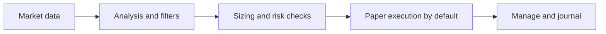

# Crypto Spot Trading Skills for Claude Code

Nine Claude Code skills that cover the full loop of a spot trading bot: get data, analyse it, size the trade, execute it, manage it, and review the results. Paper trading by default; live trading through [ccxt](https://github.com/ccxt/ccxt) on Binance, Bybit, OKX, Kraken, KuCoin, Crypto.com and other exchanges once you explicitly unlock it.

> **Not financial advice.** This is software for research and automation. Crypto trading can lose all the capital you commit. Nothing here predicts prices, and a passing backtest does not guarantee future results. You are responsible for every order placed with your API keys.

## At a glance




## Skills

| Skill | What it does | Ask Claude things like |
|---|---|---|
| `market-data` | candles, tickers, order book, exchange rules, top movers | "price and spread of SOL", "save 4h BTC candles to CSV" |
| `technical-analysis` | multi-timeframe indicators, -100..+100 confluence score, levels, trade plan | "does ETH look bullish?", "where should the stop go?" |
| `tradingview-analysis` | TradingView ratings, screeners, Pine strategy, alert webhook | "what does TradingView say on BTC 4h?", "set up TV alerts" |
| `market-scanner` | ranks the most liquid pairs by score | "what's worth trading right now?" |
| `risk-management` | position sizing, pre-trade checks, loss limits, kill switch | "how much should I buy with a stop at 61k?", "halt trading" |
| `spot-order-execution` | buy/sell/limit/stops on paper or live, preview then confirm | "buy BTC with a 2 ATR stop", "move my stop to breakeven" |
| `strategy-backtesting` | backtests, strategy comparison, walk-forward validation | "would this have worked on SOL?", "is it overfit?" |
| `trade-journal` | P&L stats, breakdowns, event log, CSV export | "how is the bot doing this week?" |
| `spot-bot-runner` | configures and runs the automated bot loop | "set up the bot for BTC and ETH on 1h", "why didn't it trade?" |

All of them share one tested library (`skills/_spotkit`), so the score Claude shows you in an analysis is the same number the backtester and the bot act on.

## Install

**As a plugin (recommended)**

```
/plugin marketplace add Fadi7AY/Claude-Crypto-Skill
/plugin install crypto-spot-trading@claude-crypto-skill
```

**Or copy the skills into a project**

```bash
git clone https://github.com/Fadi7AY/Claude-Crypto-Skill.git
cd your-bot-project
/path/to/Claude-Crypto-Skill/install.sh            # -> ./.claude/skills
# /path/to/Claude-Crypto-Skill/install.sh --global # -> ~/.claude/skills
```

Then install the Python dependencies (Python 3.10+):

```bash
pip install -r requirements.txt
```

## Quick start

Run these yourself, or just ask Claude Code - the skills trigger on plain requests.

```bash
SK=.claude/skills    # or the plugin's skills folder

# 1. create ./.spotkit/config.json
python3 $SK/spot-bot-runner/scripts/run_bot.py init --set exchange=binance

# 2. offline self-check with the built-in synthetic market
python3 $SK/spot-bot-runner/scripts/run_bot.py --demo cycle --dry-run

# 3. real data: analyse, scan, backtest
python3 $SK/technical-analysis/scripts/analyze.py BTC/USDT --brief
python3 $SK/market-scanner/scripts/scan.py --top 25
python3 $SK/strategy-backtesting/scripts/run_backtest.py --limit 8000 walkforward BTC/USDT

# 4. paper-trade
python3 $SK/spot-bot-runner/scripts/run_bot.py loop --interval 300
python3 $SK/trade-journal/scripts/journal_tool.py stats
```

## How the bot decides

1. **Signal** - confluence score on the entry timeframe (trend 35%, momentum 30%, structure 25%, volume 10%), computed on closed candles only.
2. **Filter** - the higher timeframe must not be bearish; optionally TradingView's rating must be BUY or better.
3. **Size** - risk a fixed 1% of equity between entry and stop (2 ATR or just under support), capped at 20% of equity per coin and 60% total exposure.
4. **Check** - reward:risk, liquidity, spread, cooldown after a stop-out, daily loss limit (3%), drawdown breaker (15%), kill switch.
5. **Manage** - stop, target, optional trailing stop, and exit when the score turns negative.
6. **Record** - every fill and every rejected entry goes to the journal.

All thresholds are in `.spotkit/config.json`; see the `spot-bot-runner` and `risk-management` skills.

## Safety model

- Paper mode is the default. Live orders need **all** of: `mode=live` in config, `SPOTKIT_LIVE=1` and API keys in the environment, and `--live` on the command.
- Unattended live trading (bot loop, webhook) additionally needs `live.autonomous=true`.
- Manual orders are preview-first: nothing is placed without `--confirm`.
- Spot only. Symbols containing `:` (futures/perps) are refused; there is no margin, short-selling or withdrawal code.
- API keys are read from environment variables only. Use a key with withdrawals disabled and an IP whitelist.
- Stops are enforced by the running bot ("soft stops"). If the bot is down, nothing sells. See `skills/spot-order-execution/references/live-trading.md`.

## TradingView

- Ratings and screeners use TradingView's public scanner through the `tradingview-ta` and `tradingview-screener` packages - no account needed.
- `skills/tradingview-analysis/references/spotkit_confluence.pine` puts the bot's signals on a TradingView chart.
- `tv_webhook.py` turns TradingView alerts into risk-checked orders (`references/webhooks.md`).

## Running the bot as a service

```ini
# /etc/systemd/system/spotbot.service
[Unit]
Description=Spot trading bot
After=network-online.target

[Service]
WorkingDirectory=/home/you/your-bot-project
EnvironmentFile=/home/you/.config/spotbot.env   # EXCHANGE_API_KEY=..., chmod 600; only needed for live
ExecStart=/usr/bin/python3 .claude/skills/spot-bot-runner/scripts/run_bot.py loop --interval 300
Restart=always
RestartSec=15

[Install]
WantedBy=multi-user.target
```

## Tests

```bash
python3 tests/test_offline.py
```

14 offline tests: indicator formulas, no look-ahead in the score, exact backtest accounting, every sizing cap and risk rule, the paper broker, the live broker against a fake exchange (including base-coin fees and the live locks), the bot cycle, the webhook, and the TradingView wrappers with the HTTP call stubbed.

What the tests cannot cover: your exchange's real behaviour. Before live trading, do one minimum-size round trip by hand and compare the journal with the exchange's trade history.

## Layout

```
.claude-plugin/          plugin + marketplace manifests
skills/
  _spotkit/              shared library (not a skill): exchange, indicators, signals, risk, broker, backtest, journal, tv, bot
  <skill>/SKILL.md       instructions Claude follows
  <skill>/scripts/       thin JSON CLIs over the library
  <skill>/references/    deeper docs loaded on demand
tests/test_offline.py
```

## License

MIT
